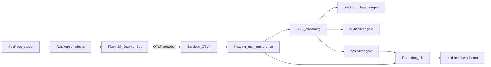
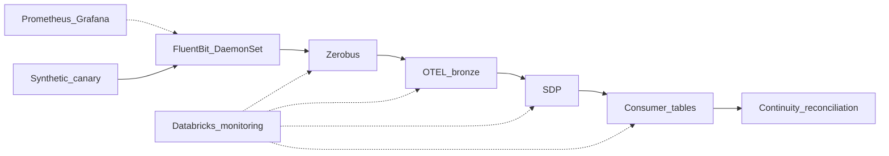
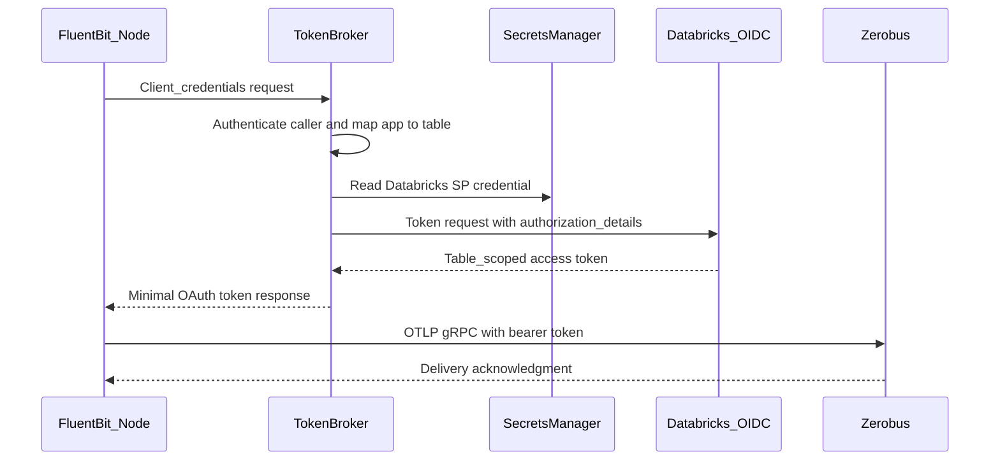

# Helix end-to-end log architecture

Architecture recommendation for the US Kubernetes log path of **Helix Clinical Cloud**, a fictional life-sciences SaaS vendor used for this prototype. The scenario and figures are illustrative, and all data in this repo is synthetic. Written against an internal platform brief, *Helix Kubernetes Log Pipeline* (current state, issues, scale, target architecture, and seven questions for Databricks). Zerobus caveats in that brief are treated as already addressed.

This primer repo proves **OTLP gRPC → official OTEL bronze → SDP silver/gold** on a laptop. It is not the full imaging-archive (DICOM) audit solution.

**Recommendation:** collect as OTEL at the node, land as OTEL in Databricks, project the legacy table in the lake. Do not reshape to `prod_app_logs` inside Fluent Bit, and do not use Zerobus REST for this volume. That matches Helix’s own target diagram (brief section 5) more closely than the later REST / legacy-schema idea.

Observability should use two independent planes:

The collector control plane must not depend exclusively on the log pipeline it monitors. If Fluent Bit cannot reach Databricks, its health and retry metrics still need to reach Prometheus/Grafana.

---

## 1. Fluent Bit topology

Use a **node-level DaemonSet**: one Fluent Bit pod per node, tailing CRI files. That is the Fluent Bit / Kubernetes default for stdout/stderr, and it is what Helix already designed.

Do **not** add:

- A per-application logging sidecar on imaging-archive pods (192 extra containers in shared dev; worse in prod).
- A second collector/aggregator hop. Brief section 6 is right: buffering, retry, and backpressure belong on the node.

Fluent Bit pipeline on each node:

- **Input:** `tail` of `/var/log/containers` + CRI parser + multiline.
- **Filters:** `kubernetes` metadata, then `grep`/`modify` to drop Istio scrapes and bulk DEBUG **before** the sink (70% of imaging-archive volume).
- **Buffer:** filesystem on **local node disk**, not NFS (Vector’s edge NFS checkpoint was already a failure mode). Tune the SQLite position DB (`storage.sync`, `db.sync`, `storage.max_chunks_up`) — the 74x disk-write vs Vector in the side-by-side test was this, not architecture.
- **Output:** one `opentelemetry` output per destination table, tagged by app (`imaging.*` → `imaging_otel_logs`). `grpc: on`, TLS 443, unlimited retry + filesystem storage until soak tests pass.
- **Routing:** one sender per node per app table. ~20 nodes → ~20 streams. That is how Zerobus wants you to scale (unbounded concurrent streams).

Keep Helix’s guardrails: NetworkPolicy, PriorityClass below clinical workloads, External Secrets, least-privilege service principal per app.

---

## 2. Protocol: OTEL/gRPC vs HTTP vs REST vs legacy mapping

| Path | Fit for 48k lines/s (floor) | Auth today | Schema | Verdict |
|---|---|---|---|---|
| OTLP gRPC to `{ws}.zerobus.{region}` | Best. Persistent stream; 100 MB/s and 100k rows/s per stream; 10 GB/s per table | Needs `authorization_details` | Official OTEL v2 | **Production target** |
| OTLP HTTP to workspace `/api/2.0/otel/v1/logs` | Workable for a soak if batched; higher TLS/request overhead | Native Fluent Bit OAuth already works (their 151k-row POC) | Official OTEL v2 | **Interim fallback** |
| Fluent Bit `http` → Zerobus REST `/zerobus/v1/tables/.../insert` | Designed for infrequent IoT; default **10k REST req/s** workspace-wide; docs say high-volume producers should use gRPC | Same `authorization_details` token as direct gRPC | Must match table columns 1:1 | **Do not use** |
| Lua/modify in Fluent Bit to 22-col `prod_app_logs` | Same REST/gRPC issues plus schema frozen at the agent | Same | Re-creates the untyped/free-text problem | **Do not use** |

Why the REST + legacy-schema idea fails:

- **REST does not avoid the OAuth problem.** Zerobus REST still requires the table-scoped token with `authorization_details`. Fluent Bit’s native OAuth cannot send that until [PR #12520](https://github.com/fluent/fluent-bit/pull/12520) lands. REST only changes the payload path.
- **REST is the wrong protocol class.** Databricks documents REST for chatty/infrequent clients. Log forwarders are listed under **gRPC**. Even with Fluent Bit JSON batching (one POST per flush, not per line), you give up stream ACKs, recovery, and headroom. Using `body_key`/`headers_key` additionally **disables batching** (one HTTP request per record — fatal at 48k/s).
- **Mapping at collect time fights Zerobus constraints.** Zerobus does not evolve schema or recreate a live target table. Encoding today’s 22-column `prod_app_logs` in Fluent Bit means every consumer-driven column change is a cluster-wide agent rollout. OTEL `VARIANT` body/attributes is the stable landing shape; typed columns are derived **once** in SDP.
- **It undoes the reasons they left Vector.** Free-text `message`, duplicate `raw`, no Unity Catalog column masks, one retention policy, audit queries that OOM.

Keep Helix’s original target: per-app OTEL bronze, then a streaming job **projects** `prod_app_logs` for existing jobs. The 15-minute consumer SLA is easy: Zerobus time-to-table is about 5 seconds. Freeze `prod_app_logs` later. Put identifiers as typed silver columns so masks work.

Official bronze template is in [`sql/create_bronze.sql`](../sql/create_bronze.sql): `CLUSTER BY (time, service_name)`, not date-only. Date-only clustering on 1.3 TB/day does not skip by service. Predictive optimization must stay on; Zerobus does not cluster files at write time. Avoid Hive-style partitioning (Zerobus caps partitioned tables at 100 partitions per 5-second window).

---

## 3. Authentication bridge: centralized token broker

Two sidecars are being conflated.

1. **App-pod logging sidecar** — extra container on every imaging-archive pod. **Not required. Do not propose it.**
2. **Token-refresh companion on the Fluent Bit DaemonSet** — second container in the **collector** pod (~20 per cluster, not 192). This is the Databricks-documented pattern until Fluent Bit can mint `authorization_details`.

There is a better interim design than (2): one **logical token-broker service** for the US Kubernetes estate. The broker is not in the log data path. Fluent Bit sends logs directly to Zerobus; it contacts the broker only to obtain or refresh an OAuth token.

### 3.1 How the broker works

Expose an internal, OAuth-compatible token endpoint such as `https://zerobus-token.internal/oauth2/token`. Point Fluent Bit’s existing `oauth2.token_url` at it. Fluent Bit already understands client-credentials responses and refreshes before `expires_in`; no mounted token file, config rewrite, or pod restart is required.

For each request, the broker:

1. Authenticates the calling Fluent Bit workload.
2. Maps the caller identity to one approved `(workspace, catalog, schema, table, service principal)` policy. The caller must not be allowed to submit arbitrary `authorization_details`.
3. Obtains the Databricks service-principal secret from the organization’s secrets manager.
4. Requests a Zerobus token from the Databricks OIDC endpoint with the fixed `resource`, `scope=all-apis`, and table-specific `authorization_details`.
5. Returns a standard, minimal OAuth response: `access_token`, `token_type`, and `expires_in`.
6. Caches the result by target table and refreshes it before expiration. All Fluent Bit instances for that app/table can receive the cached token.

The broker credentials configured in Fluent Bit authenticate only to the internal broker. They are **not** the Databricks service-principal secret. Prefer workload identity or `private_key_jwt` if the chosen Fluent Bit build and internal identity platform support it; otherwise use a low-value per-app broker client credential stored through External Secrets.

### 3.2 “Central place” should be an API, not a shared token file

A central Kubernetes Secret, AWS Secrets Manager value, or mounted file sounds simpler but has an important gap:

- An environment variable sourced from a Kubernetes Secret is fixed for the life of the Fluent Bit process.
- A projected Secret volume eventually updates the file, but a static Fluent Bit `header` value is not guaranteed to reread that file for every request.
- Restarting the entire DaemonSet every hour to consume a new Secret creates avoidable churn and a synchronized failure window.
- Cross-cluster Secret distribution introduces another replication mechanism and still does not solve in-process reload.

An OAuth-compatible broker fits Fluent Bit’s native refresh lifecycle. The broker can use a secrets manager internally, but Fluent Bit should read tokens through the OAuth endpoint rather than from shared storage.

### 3.3 Scope, deployment, and availability

Use a **single logical service, not a literal single pod**:

- Run at least two stateless replicas across availability zones behind an internal load balancer and private DNS name.
- Deploy it in the US region near the clusters and Databricks endpoint. Non-US environments remain outside this path.
- Cache tokens in memory. Replicas can mint independently; a shared cache is optional because token traffic is tiny (roughly one refresh per app/table per hour per replica).
- Add randomized refresh skew so all node agents do not refresh at the same second.
- Rate-limit by caller, but allow enough burst for cluster restarts.
- Keep serving a cached token while it remains valid if Databricks OIDC is temporarily unavailable.

The broker becomes an authentication control-plane dependency, but not a high-throughput data-plane bottleneck. If it is unavailable, existing tokens continue working until expiry and Fluent Bit’s filesystem buffer absorbs a later outage. That gives operators roughly the remaining token lifetime to restore it before ingest pauses.

### 3.4 Security boundaries

- Use one Databricks service principal per application/table, not one estate-wide identity.
- Keep Databricks client secrets only in the broker’s secret store; never distribute them to node agents.
- Authenticate and authorize every caller. An imaging-archive Fluent Bit identity can request only the imaging-archive token.
- Return only short-lived bearer tokens and never persist or log them.
- Restrict network access so only Fluent Bit namespaces/service accounts can reach the broker.
- Restrict broker egress to the Databricks OIDC endpoint and secrets manager.
- Record caller identity, target table, result, latency, and expiry metadata in audit logs—never the token or secret.
- Rotate broker-client and Databricks credentials independently.

### 3.5 Failure behavior

- **Broker down, token valid:** Fluent Bit continues to send; alert on refresh failures.
- **Broker down, token expires:** Fluent Bit retries token acquisition and buffers logs locally; it must not drop chunks.
- **Databricks OIDC down:** broker serves an unexpired cached token and retries upstream with backoff.
- **Zerobus down:** broker remains healthy, while Fluent Bit retries delivery and grows its filesystem backlog.
- **Incorrect table policy or revoked grant:** broker returns a clear non-retryable authorization error; page the identity owner rather than repeatedly minting.
- **Broker compromise:** revoke the affected service-principal secrets and broker caller credentials; table-scoped least privilege limits blast radius.

### 3.6 Fit with Fluent Bit PR #12520

Until [fluent/fluent-bit#12520](https://github.com/fluent/fluent-bit/pull/12520) merges:

- Open (opened 5 Oct 2026), awaiting `edsiper` / `cosmo0920`, `docs-required`. Adds `oauth2.authorization_details` / `_file`, 64 KiB token responses, and a form-encoding fix. **No merge or release date.**
- Do not promise a date. Options, in order:
  1. **Preferred long-term:** stock Fluent Bit once 12520 is in a 5.x release; native OAuth + OTLP gRPC; **zero extra containers**.
  2. **Preferred interim without custom Fluent Bit:** central OAuth-compatible token broker. Validate that the broker’s trimmed token response fits the response limit of the exact Fluent Bit build; PR #12520 also raises that limit from 4 KiB to 64 KiB.
  3. **If they need direct native auth now and will pin an image:** build Fluent Bit from that PR branch (Databricks-authored). Same DaemonSet, no broker or sidecar, but they own a custom image until upstream ships.
  4. **Fallback:** stay on **workspace OTLP HTTP + native OAuth** (already 100% HTTP 200 in their POC) for stage, and treat direct Zerobus gRPC as a configuration change after 12520.

The token broker is transitional. Once stock Fluent Bit can send `authorization_details` and safely parse the response, point `oauth2.token_url` back to Databricks and retire the broker without changing the OTEL data path.

Sample service, Fluent Bit output, and Kubernetes manifests: [`samples/token-broker/`](../samples/token-broker/).

This primer’s `scripts/mint_zerobus_token.py` (1-hour static token) is a laptop harness, not the production pattern.

Helm’s optional **config hot-reload** sidecar is unrelated and can stay off.

---

## 4. Scale and quotas

Treat 4.17B rows / 1.3 TB / ~48k lines/s as a **floor** (imaging-archive has grown; collection was down).

After edge DEBUG drop: ~1.24B rows/day ≈ **14k lines/s**. Uncompressed 1.3 TB/day ≈ **15 MB/s** average (peak 2.1 TB ≈ 24 MB/s).

Default Zerobus quotas (docs, 8 Oct 2026):

- 100 MB/s and **100k rows/s per gRPC stream**
- **10 GB/s per table**
- Unlimited concurrent streams
- REST 10k req/s (irrelevant if REST is not used)
- ~150 ms to durability, ~5 s to table (beats the 15-minute consumer SLA)
- Unflushed Zerobus buffer retained **28 days**, then discarded

Headroom: even **unfiltered** imaging-archive fits in **one** stream on paper. Helix will have ~20 node streams, which is the right shape for hot nodes and retries. Design for **skew** (one noisy namespace on one node), not the average.

What is **not** proven (Helix’s own list) and belongs in the stage soak, not a protocol change:

- 200x the POC rate (230 lines/s → 48k)
- Zerobus/AZ outage with filesystem buffer + unlimited retry (Zerobus is single-AZ; reconnect is mandatory)
- Line-for-line continuity vs source files (keep Grafana until this passes)
- PrivateLink path

SDP: bronze stays a **standalone** managed table (Zerobus does not create or own it). Silver streams with `skipChangeCommits` because liquid clustering maintenance can produce non-append commits. Gold as materialized views. Run the pipeline **continuous** in production (this primer used triggered runs only for laptop tests).

---

## 5. Archive and retention

Do not apply one retention policy to the raw table. That is issue #5 in the brief.

Proposed layers (numbers are starting points to confirm with compliance):

- **Never land:** Istio scrapes + bulk DEBUG at Fluent Bit. This is the cheapest archive.
- **Bronze `imaging_otel_logs`:** hot 7–14 days. `CLUSTER BY (time, service_name)`, predictive optimization on, variant shredding on. Nightly `DELETE WHERE date < current_date() - INTERVAL X DAYS` then `VACUUM`.
- **Ops silver:** 14–30 days, broad grants, short TTL, same delete job.
- **Audit silver/gold:** long retention (DICOM/SLA; often years). Typed columns only (study, site, modality, transaction id, timings). Unity Catalog column masks on identifiers. Much smaller than bronze because DEBUG is gone and the payload is projected.
- **Cold store (optional):** before bronze delete, `CREATE TABLE archive.imaging_otel_logs_yyyy_mm DEEP CLONE` or `INSERT INTO` a cheaper-storage catalog/schema (or UniForm/Iceberg if they need external engines). Query archive explicitly; do not keep it in the hot ops path.
- **Compat `prod_app_logs`:** retain only while downstream jobs still read it, then freeze/read-only as they planned.

Operational notes:

- Deletes on liquid-clustered tables are incremental if predicates hit cluster keys (`date` / `time`).
- Set `delta.logRetentionDuration` / `deletedFileRetentionDuration` to match the VACUUM window.
- Do **not** reintroduce S3 as the hot hop. Object storage is only for **cold** clones if they need it.
- Zerobus is at-least-once: silver should dedupe on `record_id` (or trace + timestamp) before audit gold.

---

## 6. Monitoring and observability

Monitoring should prove four things independently:

1. **Collection is healthy:** every expected node has a live Fluent Bit instance.
2. **Delivery is durable:** accepted records reach Zerobus and the bronze table without irreversible drops.
3. **Processing meets the SLA:** silver, compatibility, and audit outputs remain fresh and valid.
4. **Continuity is measurable:** expected source events can be reconciled through every layer.

### 6.1 Collector and Kubernetes health

Expose Fluent Bit’s Prometheus endpoint and scrape it with the existing cluster Prometheus stack. Use a `ServiceMonitor` or `PodMonitor`; keep Grafana as the operational view during migration.

Monitor:

- DaemonSet desired/current/ready pod count, unavailable nodes, restarts, OOM kills, CPU throttling, memory, and node disk pressure.
- `fluentbit_input_records_total` and `fluentbit_input_bytes_total` by input.
- `fluentbit_output_proc_records_total` and `fluentbit_output_proc_bytes_total` by destination.
- `fluentbit_output_errors_total`, `fluentbit_output_retries_total`, `fluentbit_output_retries_failed_total`, and `fluentbit_output_dropped_records_total`.
- Filesystem-buffer bytes/chunks, backlog growth, available disk, oldest buffered-chunk age, and dead-letter-queue size.
- `fluentbit_uptime` / process start time to identify restart churn.
- Tail position DB errors, paused inputs, corrupt or irrecoverable chunks, multiline/parser failures, and Kubernetes metadata lookup failures.

Alert immediately on any increase in dropped records or failed retries. Retries alone are a warning; a growing retry rate combined with a growing filesystem backlog is a delivery incident. Size local storage by **hours of outage tolerance**, not normal traffic, and alert at capacity/time thresholds such as 50%, 75%, and 90%.

Do not send Fluent Bit’s only copy of its own health logs through the same Fluent Bit → Zerobus path. Prometheus metrics and Kubernetes events are the independent diagnostic path.

### 6.2 Authentication and network

Whether authentication is native or temporarily handled by the central token broker, expose:

- Last token refresh time, next expiry, refresh failures, and consecutive failures.
- Broker replica health, request rate, cache-hit rate, upstream OIDC latency, and failures by application/table.
- HTTP 401/403 or gRPC authentication failures, separated from transport errors.
- DNS resolution, TCP connect, TLS handshake/certificate expiry, and endpoint latency.
- Secret rotation age and External Secrets synchronization status.

Page before expiration if no valid token has been obtained with at least 15 minutes remaining. Alert if both broker replicas are unavailable, if the broker serves a token for an unauthorized mapping, or if its cached token has insufficient remaining lifetime. Never log token values or client secrets.

### 6.3 Zerobus delivery

Use the regional Beta system tables:

- `system.lakeflow.zerobus_stream` for stream open/close events, protocol, target table, and per-stream errors.
- `system.lakeflow.zerobus_ingest` for records/bytes ingested and ingest errors.

Track expected open streams by application and cluster, stream churn, error arrays, records/bytes per minute, and periods with no ingest. Approximately one active stream per sending node is expected, but deployments and node replacement make this a range rather than an exact static count.

Alert on:

- No active stream or no ingested records for an application/cluster that should be producing.
- Repeated stream reconnects or any persistent error code.
- Producer output increasing while Zerobus ingest remains flat.
- Zerobus buffered-data warning events.
- Any discard event. Zerobus retains unflushed service-side data for 28 days and then discards it; a discard is a critical, irreversible-loss event.

System tables are a strong retrospective and regional monitoring source, but should not be the only low-latency page path. Producer retries/backlog usually detect an outage first.

### 6.4 Bronze landing and data quality

Create operational queries or a small monitoring gold table for every application, cluster, and environment:

- Freshness: `current_timestamp() - max(time)`.
- Rows and bytes per minute compared with a time-of-day baseline.
- Distinct `record_id` count versus row count (duplicate rate).
- Null/invalid rates for `record_id`, `time`, `service_name`, severity, cluster, namespace, and required audit identifiers.
- Unknown schema/version, oversized/truncated records, parser failures, and unexpected service names.
- Distribution changes in severity, namespace, and service to catch accidental filter/config changes.

Volume by itself is not health: a noisy service can hide a silent service. Evaluate freshness and volume at least by **application + cluster**, and by service for imaging-archive.

### 6.5 SDP and downstream processing

Lakeflow pipeline events are the primary processing observability source. Query `system.lakeflow_pipeline_events_preview.pipeline_events` (Beta), or the per-pipeline event log, for update status, flow progress, throughput, backlog, errors, lineage, and expectation results.

Monitor:

- Pipeline running state, failed/retried updates, restart loops, and checkpoint failures.
- Source backlog and input/output rows per second.
- End-to-end lag from bronze event time to silver/compatibility-table availability.
- Every expectation’s passed/failed/dropped counts and rate.
- Materialized-view refresh age and duration.
- `prod_app_logs` compatibility-table freshness against the existing 15-minute expectation.
- Audit gold completeness: instance-stored events, missing manifests, and studies excluded for malformed identifiers.

Use native pipeline notifications/event hooks for failures and a Databricks SQL alert for freshness, expectation failure rates, and consumer SLA breaches. Route pages to the existing incident-management system; dashboards alone are insufficient.

### 6.6 Synthetic canary and continuity reconciliation

Emit a small, uniquely identifiable synthetic log from every cluster at a fixed interval. Give it a `canary_id`, source cluster, service, and source timestamp, and ensure edge filters explicitly retain it. Verify its arrival in:

1. OTEL bronze,
2. typed silver,
3. `prod_app_logs` while compatibility is required, and
4. the relevant monitoring aggregate.

The canary detects total-path failure but does not prove bulk-event continuity. Add a reconciliation job that compares five-minute counts:

`source/expected → Fluent Bit input → post-filter/output → Zerobus ingest → bronze → silver/compat`

Account explicitly for intentional DEBUG/Istio filtering and at-least-once duplicates. Use stable event IDs where available; otherwise compare counts and bytes within agreed tolerances. Keep the current Vector/S3 or source-file comparison during stage until several days of line-for-line continuity have passed.

### 6.7 Retention and governance monitoring

Monitor the maintenance path as part of production:

- Archive job success, source/archive count reconciliation, oldest hot row, and newest cold row.
- DELETE/VACUUM success, table size, file count, clustering quality, and predictive-optimization status.
- Retention-policy drift between bronze, ops, audit, and compatibility layers.
- Unity Catalog grants, column-mask coverage, service-principal activity, and unexpected access via `system.access.audit`.
- Read/write lineage through `system.access.table_lineage` and `system.access.column_lineage`.

An archive run must not delete hot data until archive reconciliation succeeds.

### 6.8 Initial SLOs and alert severity

Use these as starting objectives and tune them from stage baselines:

- **Zero irreversible loss:** dropped records, failed retries, DLQ additions, or Zerobus discard events = critical.
- **Collector availability:** all schedulable log-producing nodes have a ready Fluent Bit pod; missing collector >5 minutes = critical.
- **Bronze freshness:** p95 under 60 seconds; no data for 5 minutes from an active application/cluster = critical.
- **Silver/compat freshness:** p95 under 5 minutes; 10 minutes = warning; 15 minutes = critical because it breaches the existing consumer expectation.
- **Canary:** each cluster’s canary reaches silver within 5 minutes; two consecutive misses = critical.
- **Data quality:** required-field or duplicate-rate deviation above the agreed baseline = warning; audit-key failure that prevents lifecycle reconstruction = critical.
- **Buffer safety:** warn when backlog exceeds 30 minutes or 50% capacity; critical at 75% capacity or when remaining disk is less than the tested recovery window.

Every alert needs an owner and runbook. At minimum, runbooks should distinguish source silence, collector failure, auth/network failure, Zerobus failure, bronze delay, SDP failure, and consumer-query failure.

### 6.9 Dashboard layout

Use two linked dashboards rather than one overloaded page:

- **Cluster/collector dashboard (Prometheus/Grafana):** DaemonSet coverage, collector resources, input/output rate, retries/errors/drops, filesystem backlog, disk headroom, and token/network status.
- **Lakehouse pipeline dashboard (Databricks AI/BI):** Zerobus streams/errors/throughput, bronze freshness and volume, pipeline status/backlog/expectations, silver/compat freshness, canary progression, archive status, and consumer SLA.

Both dashboards should filter by region, environment, cluster, application, service, and time range. Attach deployment/config version annotations so incidents can be correlated with Fluent Bit or pipeline changes.

---

## 7. Answers to Helix’s seven questions

1. **Does the workspace host expose OTLP over gRPC?** Their test (`grpc-status 12`) matches unimplemented on the workspace host. Do not plan on it. Direct Zerobus gRPC is the gRPC path.
2. **Is OTLP HTTP to the workspace a supported production path at this volume?** It is a supported OTLP protocol; they already proved correctness at 230 lines/s. At 48k lines/s, HTTP is a **stage fallback**, not the steady-state recommendation. You give up persistent streams, SDK-class ACK/recovery, and efficiency. You do **not** give up the OTEL table schema. REST is a step down from even HTTP OTLP.
3. **Timeline for Fluent Bit PR #12520?** Unknown. Open, code-owner review pending, docs label on. Offer: wait; use the centralized OAuth-compatible token broker; or vendor the PR image. Do not offer reshape + REST as the workaround.
4. **Table creation template and clustering?** Use the published OTEL logs v2 DDL. `CLUSTER BY (time, service_name)` and keep `date` as a column for retention deletes. Date-only clustering is weaker. No Hive-style partitioning.
5. **Quotas for ~20 nodes / one table / imaging-archive?** See section 4. They sit inside default gRPC quotas with large margin after DEBUG drop. File an account-team quota increase only if soak shows hot-node saturation, not on day one.
6. **PrivateLink?** Workspace PrivateLink covers the **workspace host** (their current HTTP OTLP URL). Direct Zerobus uses `{workspace_id}.zerobus.{region}.cloud.databricks.com` — treat as a **separate** endpoint to allowlist / PrivateLink in phase 2. Confirm with the account team before production; do not assume one private link covers both.
7. **PHI / BAA?** Engineering cannot confirm agreement coverage. Block production landing until legal/account confirms the workspace and these catalogs are in the PHI agreement. Architecture still: masks on typed silver, least-privilege service principals, no secrets in log text if avoidable.

---

## 8. Suggested wording on the two disputed points

**Legacy schema at Fluent Bit:** Zerobus should land the official OTEL logs table per app. Compatibility with `prod_app_logs` is a Databricks streaming projection, not an agent-side mapping. That preserves Unity Catalog masking, per-app isolation, and a fixed ingest schema.

**Sidecar:** This is not a request for log sidecars on clinical pods or token companions on every Fluent Bit pod. A temporary, highly available regional token-broker service can centralize `authorization_details` and return standard OAuth responses while every Fluent Bit instance continues to send logs directly to Zerobus. The broker is retired when Fluent Bit 12520 ships.

---

## References

- Helix brief: *Helix Kubernetes Log Pipeline* (Cloud Engineering, Helix Clinical Cloud, October 2026)
- [Configure OpenTelemetry (OTLP) clients](https://docs.databricks.com/aws/en/ingestion/opentelemetry/configure)
- [Zerobus API protocols](https://docs.databricks.com/aws/en/ingestion/zerobus-api-protocols)
- [Zerobus Ingest quotas](https://docs.databricks.com/aws/en/ingestion/zerobus-quotas)
- [Zerobus Ingest system tables](https://docs.databricks.com/aws/en/admin/system-tables/zerobus-ingest)
- [Fluent Bit monitoring](https://docs.fluentbit.io/manual/5.0/administration/monitoring)
- [Monitor and query Lakeflow pipeline events](https://docs.databricks.com/aws/en/ldp/monitor-and-query-events)
- [Fluent Bit OAuth PR #12520](https://github.com/fluent/fluent-bit/pull/12520)
- This repo: [`sql/create_bronze.sql`](../sql/create_bronze.sql), [`fluent-bit.yaml`](../fluent-bit.yaml), [`README.md`](../README.md), [`samples/token-broker/`](../samples/token-broker/)
